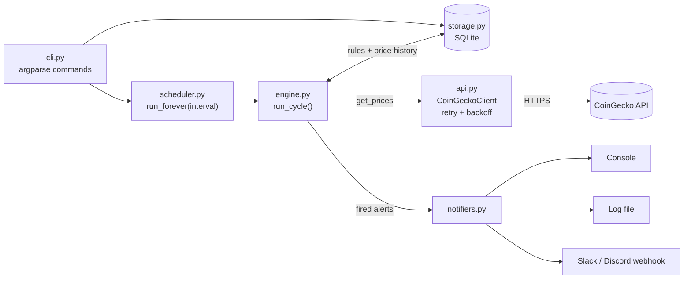

# pricewatch

A production-style **real-time crypto price alert bot**. It polls live prices from the public
[CoinGecko API](https://www.coingecko.com/en/api), stores history in SQLite, evaluates your alert
rules on an automated schedule, and notifies you via console, log file, or a Slack/Discord webhook.

- **Zero runtime dependencies**: standard library only (`urllib`, `sqlite3`, `argparse`)
- **Installable package** with a `pricewatch` console command (`pyproject.toml`)
- **Resilient**: retry with exponential backoff, per-alert cooldowns, a failed cycle never kills the scheduler
- **Tested**: unit tests with a fake API client (no network needed), CI workflow included

## Install

```bash
git clone <your-repo-url> pricewatch && cd pricewatch
python -m venv .venv && source .venv/bin/activate
pip install -e .
pricewatch --version
```

Requires Python 3.9+.

## Quick start

```bash
# 1. Create alert rules
pricewatch add bitcoin above 100000          # price >= 100,000 USD
pricewatch add ethereum below 2000           # price <= 2,000 USD
pricewatch add solana pct_change 5           # moved 5%+ since the last sample
pricewatch add bitcoin above 90000 --vs eur  # different quote currency

# 2. See what is configured
pricewatch list

# 3. Check once, or run on a schedule
pricewatch check
pricewatch run --interval 60

# 4. Inspect data
pricewatch history bitcoin --limit 10
pricewatch report --format markdown
pricewatch report --format csv --output prices.csv
```

### Notifications

```bash
pricewatch run --interval 30 \
    --log-file ~/alerts.log \
    --webhook https://hooks.slack.com/services/XXX/YYY/ZZZ
```

The webhook payload contains both `text` (Slack) and `content` (Discord) fields.

### Commands

| Command | Purpose |
|---|---|
| `add COIN {above,below,pct_change} THRESHOLD [--vs CUR]` | Create an alert rule |
| `list` | Show all rules and when each last fired |
| `remove ID` | Delete a rule |
| `check [--cooldown S --webhook URL --log-file F]` | Run one monitoring cycle |
| `run [--interval S --max-cycles N ...]` | Run continuously (Ctrl+C to stop) |
| `history COIN [--vs CUR --limit N]` | Show stored prices |
| `report [--format text\|markdown\|csv --output FILE]` | Min / max / average / latest per coin |

Global options: `--db PATH` (or env `PRICEWATCH_DB`, default `~/.pricewatch/pricewatch.db`), `-v` for debug logs.

Coin names are **CoinGecko ids** (`bitcoin`, `ethereum`, `solana`, `dogecoin`, ...).

## Architecture



One monitoring cycle:

```
scheduler tick
   |
   v
load active alerts --> group coins by quote currency --> 1 API call per currency
   |
   v
record prices in SQLite --> evaluate each rule (above / below / pct_change)
   |
   v
skip if inside cooldown --> notify all channels --> mark alert as triggered
```

| Module | Responsibility |
|---|---|
| `api.py` | HTTP client for CoinGecko; retries on 429/5xx/timeouts with exponential backoff |
| `storage.py` | SQLite schema, alert CRUD, price history, aggregate stats |
| `engine.py` | Pure `evaluate()` rule logic and the `run_cycle()` orchestration |
| `notifiers.py` | Console, file, and webhook channels (a failing webhook is logged, never fatal) |
| `scheduler.py` | Interval loop; exceptions in a cycle are logged and the loop continues |
| `cli.py` | Command-line interface |

### Alert conditions

- `above`: fires when `price >= threshold`
- `below`: fires when `price <= threshold`
- `pct_change`: fires when the absolute % change since the previous stored sample is `>= threshold`
  (the first sample only sets the baseline)

After firing, an alert stays quiet for the `--cooldown` period (default 3600 s) to avoid spam.

## Development

```bash
python -m unittest discover -s tests -v
```

Tests use an injected fake client and in-memory SQLite, so they run offline. CI runs them on
Python 3.9, 3.11 and 3.12 (`.github/workflows/ci.yml`).

### Run as a service (Linux, systemd)

```ini
# /etc/systemd/system/pricewatch.service
[Unit]
Description=pricewatch crypto alert bot
After=network-online.target

[Service]
ExecStart=/path/to/.venv/bin/pricewatch run --interval 60 --log-file /var/log/pricewatch-alerts.log
Restart=always
User=youruser

[Install]
WantedBy=multi-user.target
```

## Limitations

- CoinGecko's free tier is rate limited; keep `--interval` at 30 s or more.
- Prices are informational only and not financial advice.

## License

MIT
